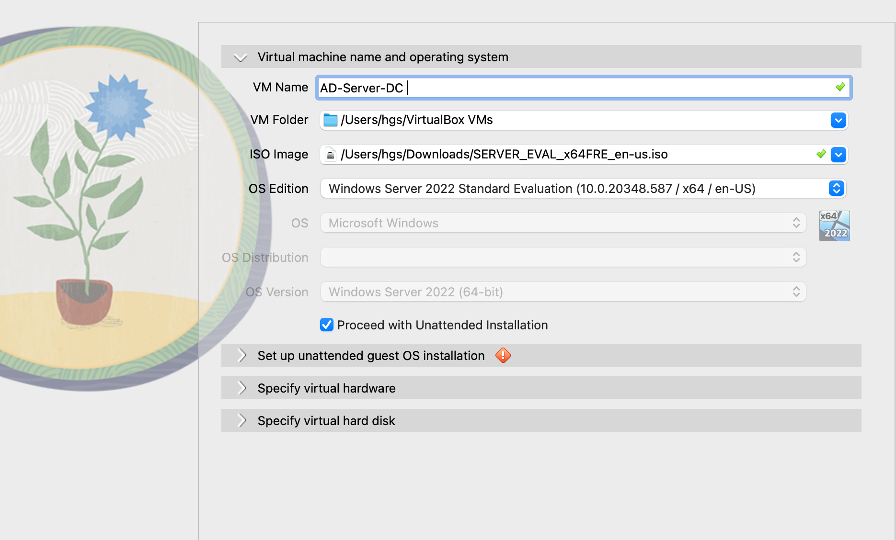
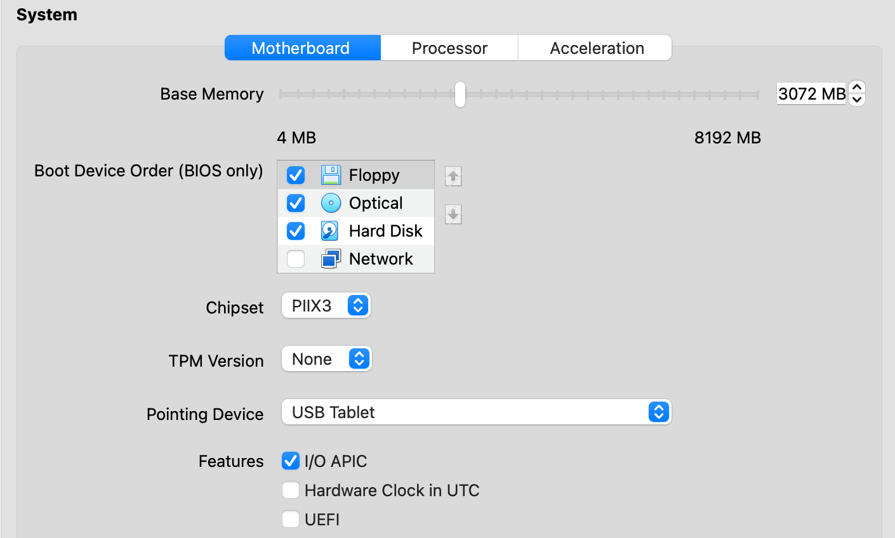
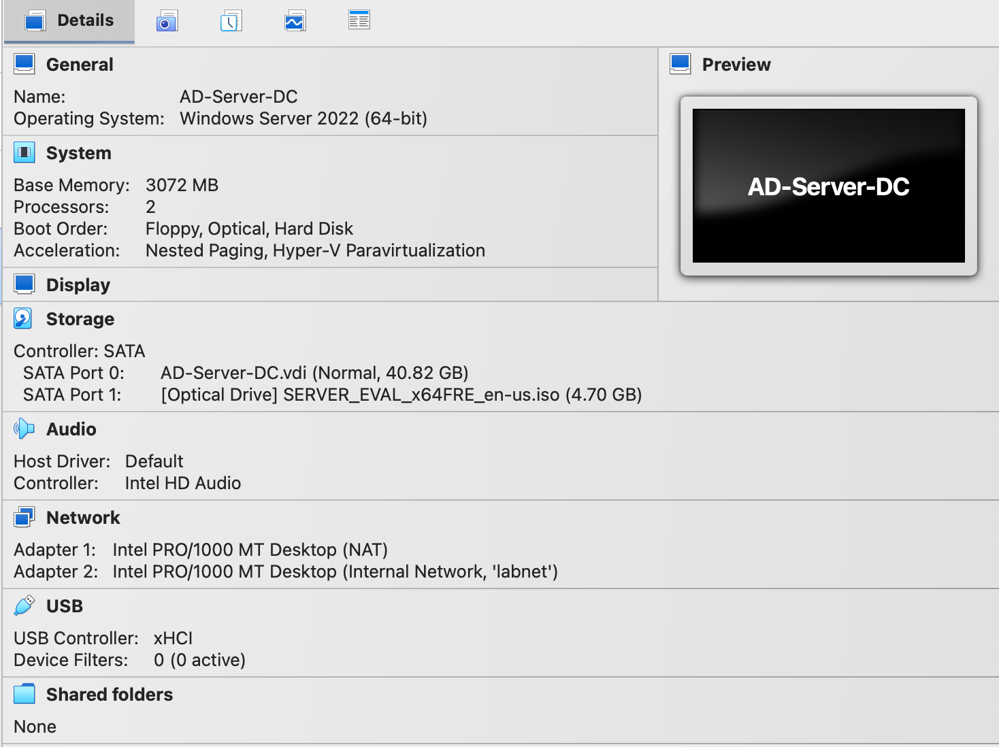
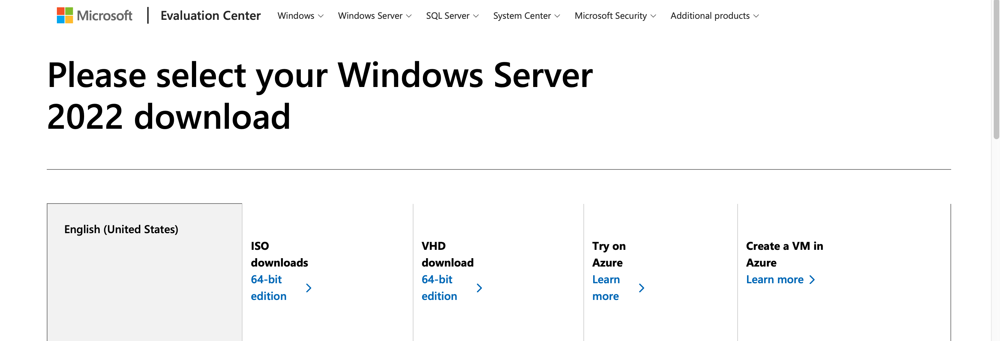
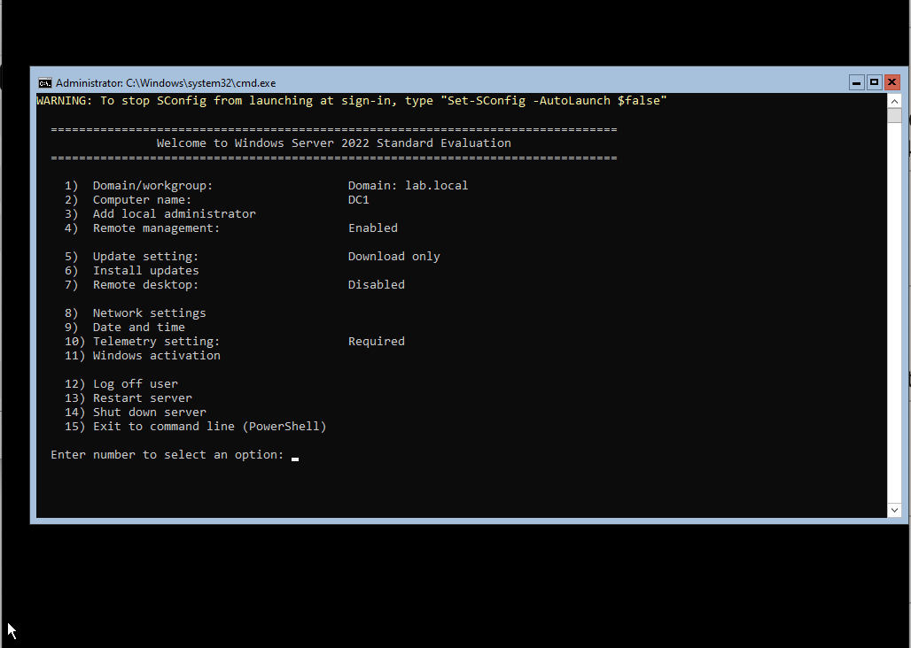

# Build a Windows AD Home Lab
This project is my first approach in breaking into helpdesk, i will be using virtualbox create a window virtual mechine which will let me run this lab in an isolated environment.
This lab is a small, safe copy of how a company manages its computers and employees.

# What is Active directory (AD)
It's a microsoft centralized directory service that provide authentication and authorization to a network resource.

# Phase 1: Windows Server VM Setup (AD Home Lab)

**Date started:** 2026-10-06
**Status:** Complete (Server Core installed, SConfig reached)
**Next phase:** Rename server, static IP, install AD DS, promote to Domain Controller

---

##  Objective

1. Install Windows Server 2022 Evaluation in VirtualBox from the Microsoft ISO.
2. Build the first virtual machine for a Windows Active Directory home lab. This VM will become the **Domain Controller (DC)**. A Windows 10/11 client VM will be added in a later phase to join the domain..
3. Get a working first sign-in and reach the SConfig menu, which confirms the install is healthy.

## Lab Setup

  
---

##  Environment 

| Item | Value |
|---|---|
| Hypervisor | VirtualBox |
| Guest OS | Windows Server 2022 Standard Evaluation (180-day trial) |
| ISO source | Microsoft Evaluation Center (x64 ISO, about 4.7 GB) |

---

## DC VM Configuration

| Setting | Value | Reason |
|---|---|---|

| Name | `AD-Server-DC` | Clear role-based name |
| Type / Version | Microsoft Windows / Windows Server 2022 (64-bit) | Matches ISO |

| RAM | 3072 MB |  
| CPU | 2 cores | Keeps the host responsive |
| Disk | 40 GB VDI, dynamically allocated | Grows as needed instead of reserving 40 GB up front |
| EFI | Disabled | Standard BIOS boot is simpler and more reliable for Windows installs in VirtualBox |
| Boot order | Floppy, Optical, Hard Disk | Optical before disk so the installer ISO boots |

I always run VMs one at a time for heavy tasks (install, updates, AD setup). Then run both together only briefly for testing domain join and logins.

---

## 4. Procedure

1. I went to th Microsoft Evaluation Center and downloaded the Windows Server 2022 Evaluation ISO.

My local host is Mac so i downloaded the iso version of window server 2022.
Then Created the `AD-Server-DC` VM in VirtualBox with the settings above,
2. Attached the ISO under **Settings, Storage, Optical Drive**.
I Booted the VM and ran the Windows Server installer, Signed in for the first time and which i was prompt to  set the Administrator password. Forgot to take screenshot of this process!
3. Reached the **SConfig** menu (Server Core's built-in configuration tool).

---

## 5. Issues Encountered and Resolutions

### Issue 1: "Can't overwrite medium" when creating the virtual disk
- **Symptom:** VirtualBox refused to create the hard disk.
- **Likely cause:** A `.vdi` file with the same name already existed from an earlier partial attempt.
- **Fix:** Use a different disk filename, or remove the leftover disk in **File, Virtual Media Manager**, then recreate.
- **Lesson:** A Failed VM creation attempts can leave orphaned files behind.

### Issue 2: "Failed to boot, missing operating system"
- **Symptom:** VM would not boot after first start.
- **Cause:** ISO not attached / boot order not checking the optical drive.
- **Fix:** Attach the ISO under **Settings, Storage**, and make sure **Optical** is ticked in **Settings, System, Boot Order**.
- **Lesson:** Check media and boot order before assuming the install is broken.

### Issue 3: "Press Ctrl-Alt-Del to unlock" would not respond
- **Symptom:** Physical Ctrl+Alt+Del on the Mac goes to macOS, not the VM.
- **Fix:** Use VirtualBox's own method: **Input, Keyboard, Insert Ctrl-Alt-Del**, or the **Soft Keyboard** (click Ctrl, then Alt, then Del so they register together). Host key on this setup is **Left Command**.
- **If keystrokes are not reaching the VM:** check macOS **System Settings, Privacy & Security, Input Monitoring / Accessibility** for VirtualBox.
- **Lesson:** Hypervisors intercept host keystrokes, so there are special shortcuts for guest key combos.

### Issue 4: "The user's password must be changed before signing in"
- **Symptom:** First sign-in demanded a password change; my own password was rejected.
- **Cause:** The Administrator account has no usable password until one is set at first sign-in, so there was no "old password" to match.
- **Fix:** Sign in as **Administrator** with a blank password, accept the change prompt, then set a new password twice.
- **Lesson:** First-login password flows differ from normal logins. This is also a common real help desk ticket type.

### Issue 5: Installed Server Core instead of Desktop Experience
- **Symptom:** After sign-in, only a command-line window with the SConfig menu appeared (no desktop, no Server Manager).
- **Cause:** On the edition screen, the plain **"Windows Server 2022 Standard Evaluation"** option is **Server Core**. The GUI version has **(Desktop Experience)** in the name.
- **Decision:** Keep Server Core. It uses less RAM (useful on an 8 GB host), reflects how many production servers run, and AD setup is done through a few PowerShell commands. AD will be managed visually later from the Windows client VM using its admin tools.
- **Lesson:** Read the edition names carefully before clicking Next.

# Build-a-Windows-AD-Home-Lab
